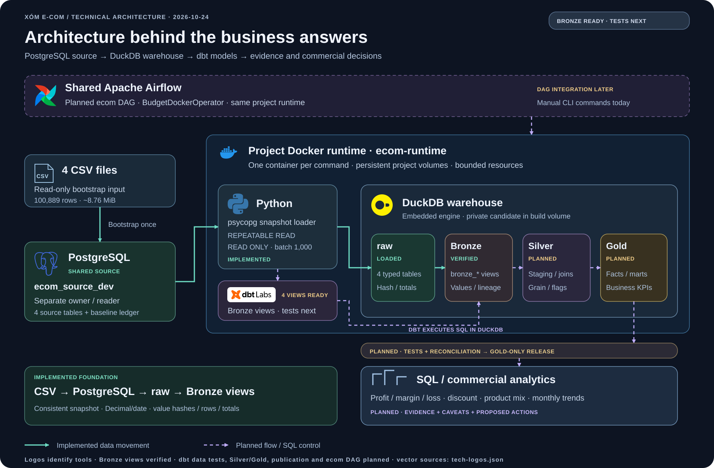
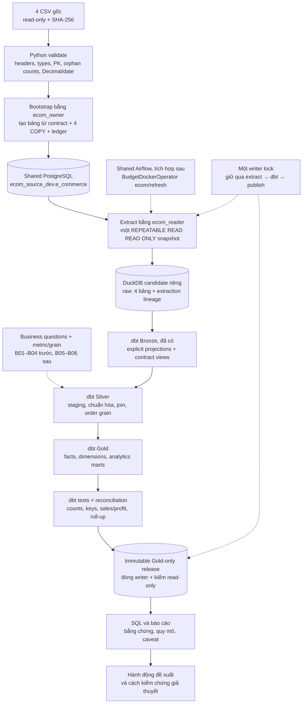

# Kiến trúc hỗ trợ dbt và commercial analytics

**Trạng thái 24/10/2026:** bootstrap/extractor đã triển khai, image đã build và 12 test fixture đạt sau khi đổi raw. Đã nạp 100.889 dòng vào bốn bảng PostgreSQL, retry skipped và extract sang DuckDB raw đạt đối soát hash/counts/nulls/totals, mở lại read-only thành công. 4 dbt Bronze views đã build/đối soát trên raw; dbt data tests, Silver/Gold, Gold publish và DAG chưa triển khai. [Bronze review](plans/raw-to-gold.md#evidence) ghi evidence và tên models thực tế. [Plan thực hành hôm nay](plans/raw-to-gold.md) hướng dẫn bootstrap tự tạo bảng → extract raw; [Docker runbook](docker.md) là nơi chạy các lệnh môi trường đã có.

## Vai trò của kiến trúc trong bài toán business

Trọng tâm hiện tại là [business questions → metric/grain → dbt → evidence/insight](plans/business-questions.md). Nền Docker/source/raw và 4 dbt Bronze views đã có để bổ sung tests rồi tiếp tục Silver/Gold; hạ tầng và số lượng models không thay cho kết quả phân tích.

P1: hiệu quả/lỗ, discount, product mix và xu hướng; P2: khách hàng/RFM và basket khi đủ dữ liệu/definitions. Mỗi model/test cần chỉ rõ bảo vệ câu hỏi nào. Bắt đầu tại [mốc raw → Bronze → Silver](plans/raw-to-gold.md); Airflow/CDC/dashboard là chặng sau các mốc phân tích đầu.


## 1. Luồng dữ liệu và điều phối chi tiết



Đường liền là luồng dữ liệu đã triển khai; đường đứt là luồng dự kiến hoặc điều khiển SQL. PostgreSQL dùng chung service nhưng tách database/roles của project; Python và dbt chạy DuckDB embedded trong project runtime. Airflow đã có trên platform, còn DAG e-commerce chưa triển khai. [Bản PNG để chia sẻ](diagrams/architecture.png), [SVG gốc](diagrams/architecture.svg), [nguồn và ghi chú logo](diagrams/tech-logos.json).

Sơ đồ dưới bổ sung các bước kiểm tra, writer lock và publication cần có khi triển khai toàn bộ luồng:



CSV dùng để **bootstrap nguồn một lần**. PostgreSQL là nguồn để thử query/transaction và, ở chặng sau, controlled OLTP changes/CDC. Python extract dữ liệu nguồn trước khi dbt biến đổi trong DuckDB. Không thêm MinIO/S3, Kafka, Cosmos hoặc Text-to-SQL vào MVP.

## 2. Đây là ETL hay ELT?

**Phần analytics là ELT:** Extract PostgreSQL → Load snapshot vào DuckDB raw → Transform bằng dbt trong DuckDB Bronze/Silver/Gold. Transform nghiệp vụ gồm join dimensions, roll-up order, facts, RFM và monthly/product metrics. Đây là cách dùng ELT theo vị trí thực thi bước transform. [dbt Labs: ELT](https://www.getdbt.com/blog/extract-load-transform).

Bootstrap CSV vẫn có validate/parse types trước khi COPY vào PostgreSQL, nên có thể gọi là **ETL nhẹ cho bước khởi tạo nguồn**. Kiểm tra format, giữ Decimal và từ chối input hỏng không làm toàn bộ luồng analytics trở thành ETL. Không mô tả dự án là “ELT thuần end-to-end” rồi bỏ qua bước chuẩn bị nguồn này.

## 3. Sao không dùng PostgreSQL cho tất cả?

**Hoàn toàn làm được.** Khoảng 100.889 dòng hiện tại không tự tạo lý do bắt buộc phải thêm một engine. Có thể dùng PostgreSQL cho source + các schemas raw/Bronze/Silver/Gold và dbt-postgres; kiến trúc sẽ ít thành phần hơn. Chưa benchmark nên không khẳng định DuckDB nhanh hơn PostgreSQL với project này.

| Cách làm | Giá trị | Phần phải quản lý |
| --- | --- | --- |
| PostgreSQL + dbt-postgres | Ít engine, không cần copy snapshot sang file analytics | Query phân tích và nguồn cùng dùng tài nguyên PostgreSQL; vẫn cần schema/quyền/transaction rõ |
| PostgreSQL source + DuckDB/dbt-duckdb | Học ranh giới nguồn/phân tích, snapshot consistency, embedded OLAP, runtime isolation | Thêm bản sao dữ liệu, đối soát giữa hai engine, file/lock/backup và adapter riêng |

Hiện giữ phương án thứ hai vì **mục tiêu học PostgreSQL, DuckDB và dbt**, và muốn phần lớn query dbt chạy trong runtime có RAM/CPU riêng thay vì trên PostgreSQL chung. Extraction vẫn dùng tài nguyên PG: không phải cách tách tải tuyệt đối. Nếu sau này ưu tiên tối giản/vận hành một engine, chuyển sang PostgreSQL-only là lựa chọn hợp lý; cần review adapter, schemas, tests và resource budget trước khi đổi, không đổi âm thầm trong lượt dọn repo.

DuckDB được thiết kế cho analytical queries và mặc định hỗ trợ embedded/in-process; đó là lý do phù hợp với bài lab local này, không phải chứng minh hiệu năng cụ thể. [Why DuckDB](https://duckdb.org/why_duckdb).

## 4. DuckDB có chạy trong Docker không?

**Có, runtime hiện đã chạy DuckDB trong Docker.** Image `ecom-runtime:local-v1` chứa Python + psycopg + DuckDB + dbt-duckdb. Thư viện DuckDB chạy bên trong process Python/dbt; file `.duckdb` nằm trong named volume, không cần thêm một service DuckDB thường trực hoặc cổng database mới. [DuckDB Docker](https://duckdb.org/docs/2.0/operations_manual/duckdb_docker.html).

| Thành phần | Nơi lưu/chạy |
| --- | --- |
| CSV gốc | `data/bootstrap/`, bind mount `/input` read-only |
| PostgreSQL source | Database `ecom_source_dev` trên warehouse hiện có |
| Candidate DuckDB | `/state/build/candidates/<extraction_id>/ecom_analytics.duckdb`, volume `ecom-dev-build` |
| dbt code | `dbt/` trong repo → `/app/dbt` trong image |
| dbt logs/reports | Volume `ecom-dev-artifacts`, theo run |
| Gold releases | Volume `ecom-dev-releases`, chỉ publish khi checks đạt |

Container runtime kết thúc và tự xóa; named volume vẫn còn. `stop` không xóa dữ liệu, `down -v` có thể xóa volumes. DuckDB của TikTok/Shopee giữ riêng file, `.venv`, locks và Dagster; không dùng chung file hoặc trỏ e-commerce vào volume/path của TikTok.

## 5. Cấu trúc dbt và schemas thật

```text
dbt/
├── dbt_project.yml
├── models/
│   ├── raw/sources.yml          # khai báo 4 nguồn do Python nạp
│   ├── bronze/                  # 4 bronze_* views đã build/đối soát
│   ├── silver/                  # staging + intermediate models
│   └── gold/                    # facts/dimensions/analytics marts
├── analyses/                    # SQL trả lời Q01–Q15
├── macros/generate_schema_name.sql
├── tests/
└── seeds/reference/
```

Python tạo physical `raw.customer/product/region/ecom_sales`; dbt khai báo bằng `source('raw', '...')`, không nạp lại CSV. Bốn views `bronze.bronze_*` đã đọc raw; Silver sẽ đọc Bronze bằng `ref('bronze_*')`, Gold đọc các models đã kiểm. Bronze mặc định view, không lưu thêm một full snapshot. Staging/intermediate là **vai trò model trong Silver**; không còn là hai physical schemas riêng. `dim_*`, `fct_*`, `mart_*` vẫn diễn tả grain/ý nghĩa bảng trong Gold.

Target schema là `silver`; config folder và macro giữ tên physical `silver`/`gold`, tránh mặc định dbt ghép thành `silver_silver`/`silver_gold`. Mỗi run/user dùng candidate file riêng nên không dùng schema prefix để cách ly cùng một file dùng chung. Raw được tạo bởi extractor; 4 Bronze views đã build và đối soát; dbt data tests và Silver/Gold models chưa triển khai. Source YAML đã chuyển sang raw; các candidate/inspection copy Bronze cũ giữ nguyên, không tự migrate. [dbt custom schemas](https://docs.getdbt.com/docs/build/custom-schemas).

## 6. Bootstrap, snapshot và lineage

Bootstrap cả bốn bảng + ledger trong một transaction bằng owner non-superuser. Ledger chứa fingerprint/version/counts; cùng input thì skip, input khác cần explicit new-baseline workflow. Không reset nguồn mỗi refresh vì có thể xóa OLTP changes được tạo sau initial load.

Extractor dùng reader non-superuser, một connection/transaction `REPEATABLE READ READ ONLY` cho bốn bảng. Named cursor đọc batch 1000 dòng, giữ Decimal/date; hash toàn giá trị business theo PK, counts/nulls/totals lấy trong cùng snapshot để đối chiếu candidate. Reader không được ghi source hoặc đọc ledger riêng trong `pipeline_meta`. Source/raw giữ sales orphan; dbt Bronze phải bảo toàn và báo counts (baseline customer=0, product=2, region=2); Silver cần LEFT JOIN và cờ unknown. Không hứa distributed transaction giữa PG và DuckDB.

Phân biệt identifiers:

- `bootstrap_id`: nhận diện CSV baseline + contract version.
- `extraction_id`: lần đọc snapshot nguồn PG; không suy ra từ CSV khi nguồn đã thay đổi.
- `analysis_run_id`: gắn source snapshot, code, tham số và kết quả tests.
- `release_id`: Gold release đã được duyệt.

Snapshot token không phải backup có thể đọc lại tùy ý sau khi transaction đóng. Full snapshot/full rebuild là mặc định; chưa cần watermark/lookback hoặc gọi polling là WAL CDC. [Plan implementation](plans/raw-to-gold.md), [OLTP/CDC sau MVP](cdc-plan.md).

## 7. Writer, publication và phục hồi

Hiện Bootstrap/Extract giữ cùng file lock trong từng lệnh. Runner refresh khi ghép các stage phải giữ một lock xuyên extract → dbt → reconcile → publish; phần ghép này chưa triển khai. Airflow concurrency 1 không thay file lock cho CLI. Đóng connection DuckDB của loader trước khi dbt subprocess ghi candidate.

**Publication dự kiến, chưa triển khai:** sau dbt/tests/reconciliation, xuất **Gold-only** sang file release mới; không copy nguyên candidate chứa raw/Bronze/customer PII. Đóng writer, kiểm read-only và atomically đổi active pointer trên cùng filesystem. Một request dùng một immutable release; readers không mở build file. Lỗi trước pointer switch giữ bản Gold tốt trước đó, retry tạo candidate mới để không append double count.

Mất build thì rebuild từ nguồn PG hiện tại. CSV chỉ tái lập baseline; để khôi phục lịch sử sau OLTP changes phải có PG backup, snapshot hoặc change journal được giữ lại. Restore scope database project, không reset cluster/volume chung.

RAM limit không phải disk limit: logs, candidates, dbt artifacts, backups và releases vẫn tăng dung lượng. Chưa có retention tự động. Khi triển khai pipeline, giữ active/previous release và evidence cần audit, chỉ dọn orphan candidates sau khi xác nhận không có writer; không `prune --volumes` tùy tiện. Thông tin bí mật/PII không nằm trong Git, logs hoặc XCom; read-only DuckDB cũng không tự là sandbox cho SQL LLM.
