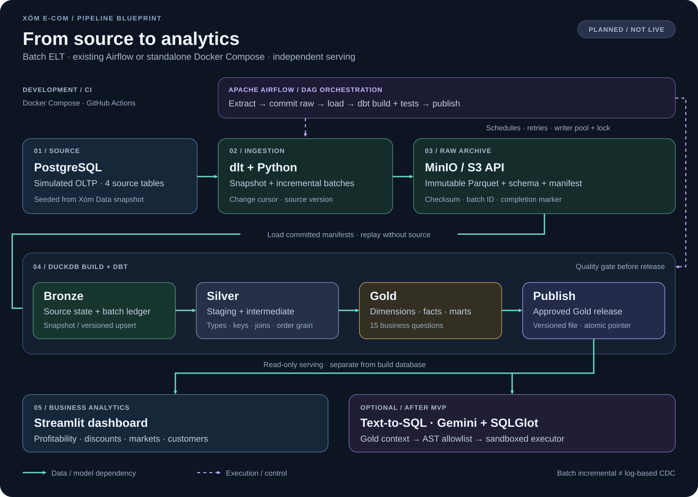

# Data flow và batch contract

> Contract đề xuất cho implementation. Chưa có code thực thi các trạng thái bên dưới.



## 1. Bootstrap và mô phỏng nguồn

Snapshot được lấy qua hình thức truy cập được Xóm Data cho phép, rồi nạp vào Postgres local. Không mặc định có public CSV download hoặc quyền CDC trên nguồn bên ngoài.

Giữ tên cột nghiệp vụ của 4 bảng. Simulator bổ sung metadata có namespace riêng: `source_updated_at`, `source_version`, `is_deleted` nếu sau này có soft delete. Việc update phải thay đổi timestamp/version trong cùng transaction nguồn. Batch mô phỏng được commit trước khi extract để kiểm soát rõ boundary.

- Initial load: full snapshot cả 4 bảng.
- Các lần sau: sales incremental theo `source_updated_at`; dimensions full snapshot có version riêng.
- Cursor dùng thời gian thay đổi ở simulator, không dùng `order_date` để phát hiện sửa đơn cũ.
- Nếu chỉ có snapshot tĩnh: chạy full snapshot và nói rõ chưa có incremental từ nguồn thật.

## 2. Extract → raw archive

Ví dụ object keys; batch date là ngày extract, không phải ngày mua hàng:

```text
raw/e_commerce/ecom_sales/extract_date=2026-10-19/batch_id=<id>/
  part-00001.parquet
  schema.json
  manifest.json
  _SUCCESS
```

`manifest.json` là metadata được lưu trong raw, không phải file cấu hình chứa secrets.

| Trường | Ý nghĩa |
| --- | --- |
| `batch_id`, `run_id`, `table`, `mode` | Định danh; mode là `snapshot` hoặc `incremental` |
| `schema_version`, `extracted_at_utc` | Phiên bản schema và thời điểm extract |
| `cursor_start`, `cursor_end`, `overlap` | Khoảng extract được ghi lại; snapshot có thể dùng null |
| `files[]` | Object key, số dòng, byte size và SHA-256 mỗi file |
| `row_count`, `schema_hash` | Đối soát payload và schema |
| `source_snapshot_id` | Nhận diện snapshot nguồn nếu có |

Trình tự commit: ghi payload → xác minh checksum/count → ghi manifest → ghi `_SUCCESS` cuối cùng. Object storage không có transaction đa file ở đây; `_SUCCESS` là commit marker theo protocol ứng dụng. Loader chỉ nhận manifest có marker và các file đã kiểm tra. Batch có `_SUCCESS` là bất biến; không append thêm file vào batch đó.

## 3. Hai checkpoint độc lập

**Extraction checkpoint** chỉ tiến sau khi raw batch committed. State dlt và checkpoint cần volume bền vững; lưu metadata recovery để truy ra boundary từ manifest khi mất state. Nếu crash sau raw commit nhưng trước checkpoint, có thể extract lại; downstream vẫn phải idempotent ở mức khóa/phiên bản.

**Warehouse checkpoint** là ledger các batch đã apply. Nếu Bronze/dbt lỗi, đọc lại raw; không extract lại từ Postgres chỉ vì downstream thất bại.

MVP dùng khoảng đọc chồng lấn có cấu hình. Overlap chỉ giảm rủi ro trong giới hạn đã chọn; không bảo đảm bắt được mọi late arrival. Với nguồn thực thay đổi liên tục cần thêm contract timestamp/transaction boundary hoặc cơ chế CDC phù hợp.

## 4. Raw → Bronze

Trong một transaction DuckDB cho từng batch:

1. Xác minh manifest, marker và checksum; từ chối schema không tương thích.
2. Kiểm tra ledger theo `(table, batch_id)`; batch đã apply thì bỏ qua có log.
3. Đọc các file trong manifest vào vùng tạm.
4. Kiểm tra khóa, phiên bản và kiểu dữ liệu.
5. Apply snapshot hoặc upsert; ghi ledger trong cùng transaction rồi commit.

**Sales incremental:** khóa ứng viên `row_id` phải vượt qua profiling trước khi dùng. Dùng `source_version` làm thứ tự thay đổi cùng khóa; không chọn winner bằng thời điểm replay. Cùng khóa/version nhưng khác payload phải fail/quarantine thay vì chọn ngẫu nhiên. Phiên bản cũ không được ghi đè mới.

**Dimension snapshot:** thay thế current snapshot như một đơn vị; không union tất cả batch vì sẽ nhân bản dimension. Archive vẫn giữ snapshot cũ. Với sales snapshot mới hoàn chỉnh, dùng replace có kiểm tra thay vì upsert để phản ánh đúng tập bản ghi của snapshot.

Hard delete sales không được suy ra từ incremental batch vắng bản ghi. Tính năng tombstone/soft delete sẽ cần contract riêng trước khi bật.

## 5. Bronze → Silver → Gold

Airflow gọi runtime `build_and_publish` sau khi raw batch đã commit. Trong cùng task, runtime giữ writer lock từ load Bronze qua dbt build, quality gate đến publish. MVP rebuild các model phụ thuộc để sửa đổi đơn cũ được phản ánh cả order, customer RFM và basket, không chỉ fact line.

Gate tối thiểu: khóa hợp lệ, relationships sau xử lý dimension, kiểm tra discount, không fan-out sau join, tổng sales/profit khớp và không trộn đơn có header mâu thuẫn. Bản Gold lỗi có thể tồn tại trong vùng build nhưng không được phục vụ cho người dùng.

## 6. Publish → serving

1. Hoàn tất `dbt build` và đối soát.
2. Xuất Gold đã duyệt sang file release riêng; không include Bronze, customer PII hoặc secret.
3. Đóng/flushing tất cả writer; kiểm tra release bằng read-only connection.
4. Ghi `release_id`, raw batch set, dbt commit/hash, `as_of_date`, test status và thời điểm publish.
5. Atomic replace pointer để người đọc mới chọn release mới.
6. Streamlit/API đóng kết nối cũ trước khi mở đường dẫn release mới; đang lỗi thì tiếp tục dùng release cũ.

Build file và ledger nằm trên volume bền vững. Airflow dùng metadata database riêng; không dùng Postgres source làm chung database nghiệp vụ và scheduler. Serving pointer không được cập nhật nếu bất cứ bước kiểm tra nào thất bại.

Giữa các Airflow tasks chỉ truyền batch ID, manifest URI và release ID qua XCom; không truyền DataFrame hoặc file DuckDB. `build_and_publish` retry phải đọc lại đúng manifest set đã chốt, không chọn raw mới nhất một cách ngầm định.

## 7. Replay và backfill

- Replay chọn tập manifest đã commit và schema tương ứng; không glob toàn bộ bucket.
- Khôi phục snapshot nền trước, rồi apply incremental batches theo version/boundary đã ghi.
- Dimension dùng snapshot hoàn chỉnh được chọn cho lần rebuild; MVP không tuyên bố join lịch sử SCD2.
- Dựng vào warehouse mới với ledger riêng, dùng cùng `as_of_date`, rồi so sánh khóa/count/sales/profit với release chuẩn.
- Backfill không tự thay đổi extraction checkpoint của luồng đang chạy.
- Chỉ publish kết quả rebuild khi gate đạt; giữ lineage tới các raw batch gốc.

Định nghĩa idempotent: cùng input và tham số tạo ra cùng tập bản ghi nghiệp vụ và metric. Run timestamp hoặc đường dẫn artifact có thể khác.
