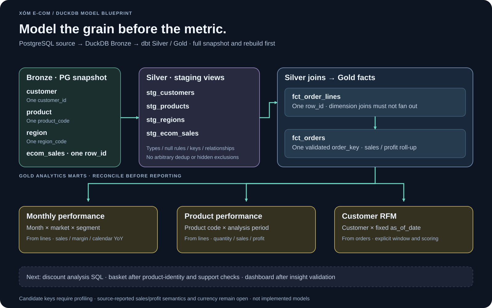

# Data modeling và grain

> Cập nhật 2026-10-24: loader đã implement/fixture-test; schema/types/PK/null/orphans đã kiểm trên CSV. Business SQL models và semantic profiling vẫn chưa hoàn thiện.



Ưu tiên model theo [business decisions và metric framework](plans/business-questions.md). Bronze/Silver tests bảo vệ câu trả lời; số lượng models hoặc test pass tự nó không phải giá trị kinh doanh.

## Model và business question phải đi cùng nhau

| Model dự kiến | Business question | Kiểm tra bảo vệ kết luận |
| --- | --- | --- |
| fct_order_lines / fct_orders | B01 hiệu quả/lỗ, B02 discount | Row/order grain, roll-up, totals, unknown coverage |
| mart_product_performance | B03 product mix | Product identity, ranking scope và contribution totals |
| mart_monthly_performance | B04 xu hướng | Calendar/period coverage, baseline và sum reconciliation |
| mart_customer_rfm | B05 khách hàng, sau P1 | Fixed as-of/window, scoring/ties, đủ thời gian quan sát |
| mart_market_basket | B06 basket, sau P1 | Distinct products/order, đúng population và đủ support |

Bảng trên là thiết kế, không phải danh sách models đã chạy. Hai staging views đầu tiên là bước chuẩn bị cho B01–B03; Raw đã typed và Bronze dự kiến giữ nguyên nên không cast lại tiền sang float để làm Silver.

## 1. Nguồn và khóa

| Nguồn | Khóa ứng viên | Cần xác nhận trước khi join |
| --- | --- | --- |
| `ecom_sales` | `row_id` | Unique/not-null; scope `order_id`; thiếu FK; header trong cùng đơn có nhất quán không |
| `customer` | `customer_id` | Duplicate giống hệt hay xung đột; null thuộc tính |
| `product` | `product_code` | Một mã có nhiều tên/category không; có thực sự nhận diện một SKU không |
| `region` | `region_code` | Một mã ứng với một bộ thuộc tính địa lý không |

Tên cột nguồn tham khảo: [sales](https://dataset.xomdata.com/datasets/e_commerce.ecom_sales), [customer](https://dataset.xomdata.com/datasets/e_commerce.customer), [product](https://dataset.xomdata.com/datasets/e_commerce.product), [region](https://dataset.xomdata.com/datasets/e_commerce.region).

Không dùng `(order_id, product_code)` làm khóa dòng mặc định. Nếu order ID không unique theo scope toàn bộ dataset, cần tạo `order_key` từ business scope đã kiểm chứng và dùng thống nhất ở mọi downstream model.

## 2. DuckDB raw và dbt Bronze

`raw.ecom_sales`, `raw.customer`, `raw.product`, `raw.region` giữ typed PostgreSQL snapshot và extraction lineage, do Python nạp. Mỗi candidate nhận đủ 4 bảng, không union các snapshot. dbt đọc `source('raw', ...)`; bạn đã viết `bronze.bronze_ecom_sales`, `bronze_customer`, `bronze_product`, `bronze_region` bằng explicit projections giữ keys/values/lineage. Bronze dùng view; Silver sẽ đọc `ref('bronze_*')`. Xem mẫu macro và tests trong [plan thực hành](plans/raw-to-gold.md).

CSV chỉ lưu baseline bootstrap. Source có OLTP changes thì cần PG backup/change journal để phục hồi lịch sử; không có MinIO archive. Xem [snapshot contract](architecture.md).

## 3. DuckDB Silver · staging views

| Model | Grain | Trách nhiệm |
| --- | --- | --- |
| `stg_ecom_sales` | Một source sales row | Cast, naming, kiểm tra khóa, giữ sales/discount/profit nguồn |
| `stg_customers` | Một customer sau giải quyết duplicate | Chuẩn hóa thuộc tính; không tự điền suy diễn |
| `stg_products` | Một product code sau xác nhận grain | Exact dedup nếu hợp lệ; xung đột phải có quy tắc |
| `stg_regions` | Một region code sau xác nhận grain | Chuẩn hóa địa lý/thị trường |

Dedup không phải mặc định dùng `ROW_NUMBER()` rồi lấy bất kỳ dòng đầu. Exact duplicate có thể collapse có audit; conflicting duplicate phải quarantine hoặc fail cho tới khi có business rule. Giữ precision decimal và phân biệt null với zero.

## 4. DuckDB Silver · joins và order grain

| Model | Grain | Logic |
| --- | --- | --- |
| `int_order_lines_enriched` | Một sales row | Join dimensions đã unique; giữ dòng thiếu FK bằng chính sách unknown rõ ràng |
| `int_orders_aggregated` | Một order key | Tổng sales/profit/quantity, số dòng, cờ đơn lỗ; kiểm tra customer/date/segment nhất quán; region nếu dùng làm thuộc tính cấp đơn |
| `int_customer_order_history` | Một customer × order key | Thứ tự mua và khoảng cách giữa lần mua |
| `int_order_products` | Một order key × product code | Distinct sản phẩm trước basket |
| `int_order_product_pairs` | Một order key × cặp sản phẩm | Self-join với `product_a < product_b` |

Baseline có 0 sales orphan customer, 2 orphan product và 2 orphan region (các tập có thể chồng nhau). Source/raw giữ toàn bộ; Bronze phải bảo toàn và báo counts, không tạo FK cứng. Silver dùng LEFT JOIN và cờ unknown; chưa tự tạo dimension member giả. Không để inner join âm thầm làm mất sales; không để duplicate dimension nhân doanh thu. Policy unknown phải được đo đếm và có ngưỡng chấp nhận được ghi trong config.

## 5. DuckDB Gold / marts · facts và aggregates

| Model | Grain | Sử dụng |
| --- | --- | --- |
| `dim_customers` | Một customer | Thuộc tính phân tích; loại PII khỏi serving |
| `dim_products` | Một product code | Category/subcategory và nhãn sản phẩm |
| `dim_regions` | Một region code | Các chiều địa lý/thị trường theo schema |
| `dim_date` | Một calendar date | Calendar spine, tháng/năm và YoY |
| `fct_order_lines` | Một sales row | Sales, profit, quantity, discount và các dimension keys |
| `fct_orders` | Một order key | AOV, order count, loss-making orders |
| `mart_monthly_performance` | Một tháng × market × segment | Sales, profit và YoY theo cùng grain |
| `mart_category_discount_impact` | Một category × segment trong kỳ | Discount, sales, profit; quan sát tương quan |
| `mart_customer_rfm` | Một customer × as_of_date | R/F/M, phân nhóm và cờ VIP at-risk theo quy tắc |
| `mart_product_performance` | Một product code × period_start × period_end | Quantity, sales, profit và ranking |
| `mart_market_basket` | Một cặp product codes × period_start × period_end | Basket count, support, confidence hai hướng, lift |

Ưu tiên triển khai Silver đúng grain, `fct_order_lines`, `fct_orders`; profit/margin/loss/discount analyses trước, monthly/product marts tiếp theo; RFM sau khi chốt as-of/window và rule. Category discount có thể trả bằng analysis SQL; basket chỉ thêm sau khi product identity/population đã xác nhận. Không cần tạo tất cả models ngay để trả lời câu hỏi đơn giản.

Các facts/dimensions/analytics models cùng nằm trong schema `gold` ở MVP; staging và intermediate models nằm trong `silver`. Code tổ chức tại `dbt/models/bronze`, `silver`, `gold`; Raw source declarations nằm ở dbt/models/raw/sources.yml; Bronze gồm bốn SQL views đã build/đối soát; dbt source/model tests vẫn chưa triển khai, xem [review](plans/raw-to-gold.md#evidence). `dim_*` mô tả thực thể; `mart_*` chứa metric và mốc thời gian. Không gộp RFM vào customer dimension như một thuộc tính tĩnh. Lịch sử dimension trong MVP là current-state; chưa bảo đảm thuộc tính đúng tại thời điểm giao dịch.

## 6. Metric contract cần chốt

| Metric | Định nghĩa dự kiến / điều kiện |
| --- | --- |
| Revenue | Tổng `sales`, tạm gọi source-reported sales; chưa áp nhãn gross/net |
| Profit | Tổng `profit` nguồn; chưa khẳng định là net profit sau mọi loại chi phí |
| Profit margin | `SUM(profit) / NULLIF(SUM(sales), 0)` |
| AOV | Tổng sales / số order keys hợp lệ |
| Loss-making order | `SUM(profit)` toàn đơn < 0; không đếm riêng từng dòng lỗ thành đơn lỗ |
| Average discount | Q5 mặc định đề xuất AVG theo dòng; cần xác nhận thang 0..1; weighted discount là metric khác |
| RFM recency | Số ngày từ lần mua cuối tới `as_of_date`, chỉ xét giao dịch tới ngày này |
| RFM frequency | Số đơn distinct trong cửa sổ đã định nghĩa |
| RFM monetary | Tổng sales trong cùng cửa sổ |
| YoY | So tháng với đúng tháng năm trước bằng date spine; thiếu baseline trả null/cờ thiếu, không dùng LAG trên tập tháng khuyết |

Chưa xác nhận currency nhất quán thì tổng tiền xuyên thị trường chỉ là số source-reported, chưa đủ làm so sánh tài chính giữa thị trường. Phải chốt đơn vị hoặc tách nhóm tiền tệ trước khi kết luận.

Không suy ra cost hoặc gross sales từ sales/discount/profit khi chưa xác nhận semantic nguồn. Phân tích discount impact là mô tả quan sát, chưa chứng minh discount gây thay đổi lợi nhuận.

RFM dùng `as_of_date` làm tham số bắt buộc; mặc định demo có thể là ngày sau max order_date của tập dữ liệu, ghi lại trong metadata. Nếu dùng NTILE(5), phải quy định chiều score và tie-break deterministic; khách cùng giá trị có thể bị chia hai nhóm, cần nêu hạn chế. Ngưỡng VIP/churn và cửa sổ mua là quyết định nghiệp vụ chưa chốt.

## 7. Market basket

Trong cùng kỳ phân tích, N là số đơn đủ điều kiện, n(A), n(B) là số đơn chứa từng sản phẩm, n(A,B) là số đơn chứa cả hai:

```text
support(A,B)     = n(A,B) / N
confidence(A→B) = n(A,B) / n(A)
confidence(B→A) = n(A,B) / n(B)
lift(A,B)        = n(A,B) * N / (n(A) * n(B))
```

Đơn chỉ có một sản phẩm vẫn nằm trong N. Không nhân count theo quantity hay số dòng lặp. Cần minimum basket count/support trước khi diễn giải lift và ghi rõ tập đơn bị loại vì thiếu mã sản phẩm.

## 8. Quality gate dự kiến

- `unique`, `not_null` tại đúng grain. Relationships/unknown policy phải xử lý các orphan đã biết; không thêm strict relationship rồi drop sales để làm test xanh.
- `accepted_values` lấy từ profiling/contract, không suy đoán enum từ vài sample.
- Discount trong khoảng đã xác nhận; kiểm tra null riêng, không để range test bỏ qua null ngoài ý muốn.
- Một order key có một customer/date/segment theo contract; sai thì fail/quarantine.
- Trước/sau join: row count và tổng sales/profit không đổi ngoài exclusions có audit.
- `fct_orders` roll-up khớp `fct_order_lines`; không duplicate khi retry.
- RFM không sử dụng giao dịch sau as-of; basket không self-pair và support/confidence trong [0,1].
- Synthetic fixtures cho duplicate dimension, order roll-up, tháng thiếu, RFM as-of và product lặp trong đơn.

Tất cả gate phải chạy thật khi có implementation; tài liệu hiện tại không tuyên bố test đã pass.

## 9. Từ query tới insight

Dùng B01–B06 trong [plan commercial analytics](plans/business-questions.md) để nối model/test tới quyết định. Bộ Q01–Q15 là query backlog, không phải 15 kết luận bắt buộc.

Mỗi kết luận ghi question ID, grain, population, kỳ, metric definition, extraction_id, analysis_run_id và SQL. Ba hướng khởi đầu: thị trường/segment tạo sales nhưng margin thấp; category có discount cao đi cùng loss-order rate cao; khách có monetary/frequency cao nhưng recency dài. Đây là **giả thuyết để kiểm tra**, chưa phải kết quả dữ liệu.

Sau mỗi phát hiện phải có quy mô ảnh hưởng, hành động đề xuất và giới hạn. Discount không chứng minh quan hệ nhân quả; RFM risk là rule-based, không phải churn đã quan sát; basket chỉ mô tả đồng xuất hiện.
