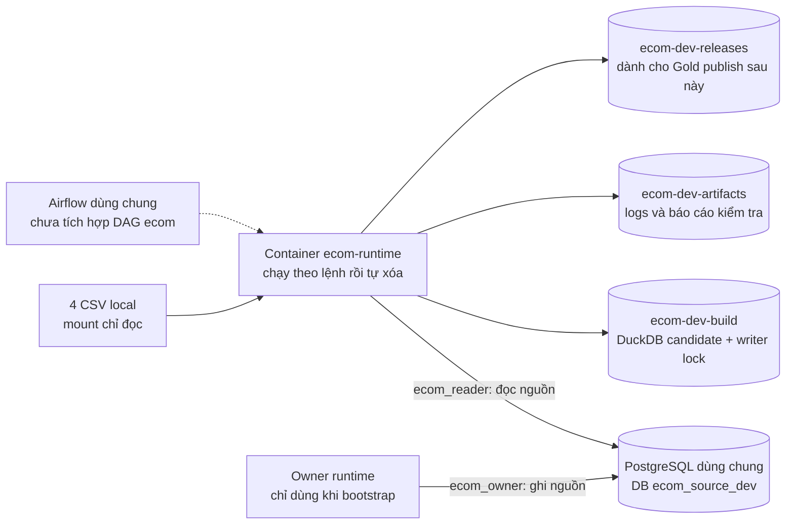

# Chạy môi trường e-commerce bằng Docker

**Môi trường dev đã được triển khai ngày 2026-10-24.** Có runtime Python + psycopg + DuckDB + dbt-duckdb, database/users riêng trên PostgreSQL chung và các lệnh kiểm tra bên dưới. Chưa nạp CSV, chưa có models/insight hoặc DAG; `dbt debug` chỉ kiểm tra môi trường, không chứng minh pipeline đã chạy.

## 1. Hiểu đúng thành phần đang dùng



Không có DuckDB server, MinIO hay PostgreSQL container mới. `compose.shared.yaml` dùng network `laplaptech-lab` và warehouse hiện có. Build image không nạp CSV hoặc secrets vào image. Hai service `runtime` và `owner` dùng cùng image nhưng chỉ được mount mật khẩu đúng vai trò; mặc định dùng reader.

| Thành phần | Cấu hình |
| --- | --- |
| Image | `ecom-runtime:local-v1`, Python base ghim digest; dependencies trong `requirements.lock.txt` |
| Runtime | 1024 MiB RAM, 1 CPU, 256 PID, không swap; chạy user 10001, root filesystem chỉ đọc |
| DuckDB/dbt | 512 MB memory, 1 thread, spill tối đa 1 GB trong build volume |
| PostgreSQL source | `ecom_source_dev`; schemas `e_commerce`, `pipeline_meta` |
| Owner / reader | `ecom_owner` / `ecom_reader`, đều không có quyền admin; connection limit 4 / 2 |
| Credentials | `.local/secrets/owner.password`, `.local/secrets/reader.password`, không commit |
| Resource policy | `projects.ecom.tasks.refresh`: 1024 MiB/1 CPU, 2 slot trong pool chung; chưa có DAG sử dụng |

## 2. Bật PostgreSQL nguồn

Mở Docker Desktop trước. Với platform trên máy maintainer, chỉ bật warehouse:

```powershell
Set-Location 'D:\Dev\Project\airflow-platform'
docker compose --env-file .env -f compose.yaml -f compose.laplaptech.yaml up -d --no-deps warehouse-laplaptech
docker compose --env-file .env -f compose.yaml -f compose.laplaptech.yaml ps warehouse-laplaptech
```

Chờ `healthy`. Các lệnh CLI môi trường yêu cầu **shared scheduler đang tắt** để tránh Airflow đồng thời nhận job ngoài cửa sổ kiểm tra thủ công. Không tắt một platform đang có task của project khác: dùng Manager để drain/off trước khi chuyển sang cửa sổ CLI. Khi tích hợp DAG sau này, dùng `BudgetDockerOperator`; không cần tắt scheduler để chạy qua Airflow.

Người clone chưa có platform phải đọc quy ước của platform mình đang dùng và cấp DB/roles theo phần dưới. **Compose standalone cho người chưa có shared platform chưa được triển khai.** Không chạy bootstrap LapLapTech để ghi đè workspace chung.

## 3. Cấu hình lần đầu

```powershell
Set-Location 'D:\Dev\Project\e_commerce'
.\scripts\Initialize-LocalEnv.ps1
docker compose -f compose.shared.yaml config --quiet
```

Script tạo root `.env` từ mẫu và sinh hai mật khẩu ngẫu nhiên riêng. Chạy lại giữ nguyên file và mật khẩu hiện có. Không cần activate venv hoặc cài Python packages trên Windows. Các script dùng PowerShell 7 và Docker CLI.

Trên máy này database/roles đã được cấp. Khi setup một shared warehouse mới tương thích, admin chạy **một lần**, sau khi kiểm tra đúng target:

```powershell
.\scripts\Provision-SharedSource.ps1
```

Script quản trị này khóa vào container/role admin hiện tại của platform, kiểm PostgreSQL 16 và database `postgres`, rồi tạo database/roles riêng nếu **tất cả đều chưa tồn tại**. Nó không reset password hoặc xóa DB có sẵn; trạng thái tạo dở phải được kiểm tra trước khi thử lại. Runtime không nhận credential admin. Script tạo hai schema rỗng và default privilege SELECT cho bảng do owner tạo trong `e_commerce`; không tạo bốn bảng nghiệp vụ. Reader không được ghi nguồn hoặc truy cập `pipeline_meta`.

Khi thêm máy khác, điều chỉnh phần admin target có chủ đích theo contract của platform đó. Trong registry vận hành phải có entry `ecom/refresh` theo [mục 7](#7-registry-ecom); wrapper sẽ từ chối nếu chưa đăng ký.

## 4. Build và kiểm tra

```powershell
Set-Location 'D:\Dev\Project\e_commerce'
$ecomPlatformDir = 'D:\Dev\Project\airflow-platform'
.\scripts\Invoke-Dev.ps1 -Action Build -PlatformDir $ecomPlatformDir
.\scripts\Invoke-Dev.ps1 -Action Versions -PlatformDir $ecomPlatformDir
.\scripts\Invoke-Dev.ps1 -Action Check -Role reader -PlatformDir $ecomPlatformDir
.\scripts\Invoke-Dev.ps1 -Action Check -Role owner -PlatformDir $ecomPlatformDir
.\scripts\Invoke-Dev.ps1 -Action DbtDebug -PlatformDir $ecomPlatformDir
```

`Invoke-Dev.ps1` đọc registry thật, kiểm scheduler đang tắt, giới hạn của container đang chạy và phần RAM còn lại, rồi chạy Compose với đúng resource cap. Đây là kiểm tra tại thời điểm bắt đầu: không đồng thời bật stack hoặc chạy writer khác trong cửa sổ CLI. Docker BuildKit có tiến trình build riêng; phép tính này không phải trần RAM riêng cho từng bước build. Build khi các project nặng đang tắt, như lần triển khai ban đầu.

`Check` xác thực mật khẩu qua TCP, đúng database/user, role không có quyền admin, schema ACL; thử ghi/đọc DuckDB và các volume bằng dữ liệu tổng hợp rồi xóa file thử. Nó không đọc/in các dòng khách hàng. Báo cáo `source_tables: 0` hiện là đúng vì chưa bootstrap CSV. `input_files_present: false` nghĩa thiếu CSV local, không phải PostgreSQL lỗi.

`DbtDebug` dùng DuckDB tạm trong build volume và profile thật; thành công có `All checks passed`. Không có models nên chưa chạy `dbt run/build/test/freshness` cho pipeline. File lock `.writer.lock` phải được tái sử dụng khi viết refresh; sau extract phải đóng DuckDB trước khi gọi dbt.

Report cuối lưu trong volume `ecom-dev-artifacts` tại `environment-latest.json`. `dbt debug` có log theo lần chạy; kiểm tra và dọn artifacts đúng project theo nhu cầu, không có retention tự động. Input CSV và file report không được bake vào image.

## 5. Bật/tắt và kiểm tra nhanh

```powershell
Set-Location 'D:\Dev\Project\e_commerce'
docker compose -f compose.shared.yaml ps -a
```

Runtime dùng `run --rm`, kết thúc là container tự xóa; không cần giữ Python/dbt chạy ngầm. Không dùng `docker compose up -d` để duy trì job môi trường. PostgreSQL chung vẫn chạy và có thể phục vụ project khác; chỉ dừng warehouse khi đã xác nhận mọi consumer của nó đều ngừng. Không dùng `down -v` để tắt: named volumes chứa state của project.

Đăng nhập bằng DataGrip/DBeaver từ Windows:

| Trường | Giá trị |
| --- | --- |
| Host | `127.0.0.1` |
| Port | `WAREHOUSE_HOST_PORT` từ `.env` platform, hiện `55434` |
| Database | `ecom_source_dev` |
| User | `ecom_owner` để bootstrap; `ecom_reader` để đọc |
| Password | Đọc đúng file local của role trong `.local/secrets/` trên máy mình |

Nếu báo sai mật khẩu, dùng lại file secret đã provision. Sửa `.env` hoặc sinh file secret mới không tự đổi mật khẩu trong volume PostgreSQL. Không xóa volume hay reset tài khoản của project khác để chữa lỗi đăng nhập.

## 6. Công việc tiếp theo

1. Chốt types/grain/FK và viết DDL cho bốn bảng nguồn.
2. Bootstrap CSV atomic/idempotent bằng owner; extract consistent snapshot bằng reader.
3. Xây dbt models/tests, reconciliation và immutable Gold publish.
4. Khi CLI refresh đạt, thêm DAG + config mounts riêng vào shared Airflow; giữ pool chung và một writer.

Tham khảo: [Compose services](https://docs.docker.com/reference/compose-file/services/), [dbt-duckdb profile](https://github.com/duckdb/dbt-duckdb), [Psycopg connections](https://www.psycopg.org/psycopg3/docs/api/connections.html).


## 7. Registry ecom

Registry vận hành đã có `projects.ecom`: `dbt_threads=1`, `services={}`, task
`refresh={"memory_mib":1024,"cpus":1}`. Task dùng hai slot trong pool chung;
không thêm service thường trực hoặc tăng pool. DuckDB nằm trong runtime, code
dbt ở `/app/dbt`, schemas là `bronze`/`silver`/`gold`; macro giữ tên schema
đúng thay vì ghép thành `silver_gold`. Bronze do extractor nạp, source YAML
chưa tạo dữ liệu.

Standalone Compose, bootstrap/extract, business models/tests, Gold publication,
DAG distribution và CI còn là các bước triển khai tiếp theo theo
[roadmap](roadmap.md). Khi sửa code Python/dbt/Dockerfile, rebuild bằng Action
Build; không sửa dependencies trong runtime đang chạy hoặc dùng `.venv` TikTok.
