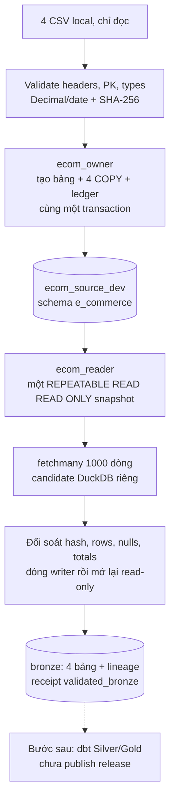

# Bootstrap CSV → PostgreSQL → DuckDB Bronze

**Phạm vi:** hoàn thiện hai loader trước dbt Silver/Gold. Bootstrap tự tạo bảng từ contract Python; không cần viết hoặc chạy file DDL riêng.

Ngày 24/10/2026: image đã build, 10 kiểm tra fixture đạt. Dữ liệu thật đã nạp đủ 100.889 dòng vào PostgreSQL; retry bootstrap skipped. Extract sang DuckDB Bronze đã đối soát hash/counts/nulls/totals, lineage và mở lại read-only thành công.

## 1. Luồng chạy



Bootstrap khởi tạo nguồn PostgreSQL một lần. Các lần extract sau đọc **PostgreSQL hiện tại**, không đọc lại CSV hoặc nạp lại baseline. Hiện dùng full snapshot, chưa có watermark/lookback hoặc WAL CDC.

## 2. Chuẩn bị

- Docker Desktop đang chạy, warehouse chung healthy. Shared scheduler OFF trong cửa sổ CLI; không tắt công việc của project khác để chạy thử.
- Database, schemas và hai role đã provision theo [Docker runbook](../docker.md). Không chạy provisioning lại chỉ để nạp CSV.
- Đủ 4 file tại `data/bootstrap/`: `customer.csv`, `product.csv`, `region.csv`, `ecom_sales.csv`.
- `.local/secrets/owner.password` và `reader.password` phải là **file** chứa mật khẩu đã cấp cho đúng role. Nếu mất, khôi phục từ nơi lưu trước đó; script không tự đặt lại mật khẩu database đã tồn tại.

```powershell
Set-Location 'D:\Dev\Project\e_commerce'
$ecomPlatformDir = 'D:\Dev\Project\airflow-platform'
.\scripts\Invoke-Dev.ps1 -Action Build -PlatformDir $ecomPlatformDir
.\scripts\Invoke-Dev.ps1 -Action Check -Role owner -PlatformDir $ecomPlatformDir
.\scripts\Invoke-Dev.ps1 -Action Check -Role reader -PlatformDir $ecomPlatformDir
```

Runtime 1024 MiB/1 CPU, DuckDB 512 MB/1 thread. Wrapper kiểm ngân sách thật trước khi chạy; không bật thêm stack nặng đồng thời.

## 3. Bootstrap vào PostgreSQL

```powershell
.\scripts\Invoke-Dev.ps1 -Action Bootstrap -Role owner -PlatformDir $ecomPlatformDir
```

Lần đầu trả `status: loaded`; cùng CSV/contract chạy lại trả `status: skipped`. Nếu baseline đổi hoặc schema cũ không đúng contract, loader dừng và giữ nguyên nguồn. Chưa có workflow tự thay baseline.

Code: [load_csv.py](../../scripts/bootstrap/load_csv.py), [typed contract](../../ingestion/sources/table_contracts.py), [CSV parser](../../ingestion/sources/csv_contracts.py).

1. Đọc/validate/hash cùng payload sẽ nạp; reject header sai, PK trùng/rỗng, lỗi ngày hoặc số bị làm tròn.
2. Giữ file lock trên build volume; kiểm đúng database/owner và quyền non-admin.
3. Một PG transaction + advisory lock bao quanh kiểm ledger, tạo bảng, bốn COPY, đối soát và ghi ledger.
4. Lỗi ở bất kỳ bảng nào rollback toàn bộ; không DROP/TRUNCATE/upsert hoặc tự sửa schema cũ.

Ledger `pipeline_meta.bootstrap_runs` lưu hashes/version/counts của baseline; reader không được đọc ledger. Retry cùng baseline giữ nguyên OLTP changes phát sinh sau initial load, không ép nguồn hiện tại trở lại CSV.

### Contract đã kiểm trên CSV local

| Bảng | Dòng CSV = PostgreSQL = DuckDB | PK |
| --- | ---: | --- |
| customer | 17.415 | customer_id |
| product | 28.356 | product_code |
| region | 3.828 | region_code |
| ecom_sales | 51.290 | row_id |

- Tổng 100.889 dòng; identifiers giữ text, không dedup sales theo order_id.
- Ngày ISO YYYY-MM-DD; quantity là BIGINT.
- Income/sales/profit: NUMERIC(20,2); discount: NUMERIC(9,6); tọa độ: NUMERIC(12,6). DuckDB dùng DECIMAL tương ứng; không chuyển tiền qua float.
- Chuỗi rỗng/NULL trở thành null nếu cột cho phép; baseline có 124 null ở customer.gender.
- Sales không khớp customer: 0, product: 2, region: 2. Đây là số **dòng sales**, có thể chồng nhau. Policy **preserve_and_report** giữ toàn bộ và báo số lượng, chưa tạo FK cứng làm bootstrap thất bại. Silver cần LEFT JOIN và cờ unknown.
- Currency, gross/net, order scope vẫn cần xác minh nghiệp vụ trước khi tính insight.

## 4. Extract sang DuckDB Bronze

```powershell
.\scripts\Invoke-Dev.ps1 -Action Extract -Role reader -PlatformDir $ecomPlatformDir
```

Kết quả đạt có `status: validated_bronze`, `candidate`, `extraction_id`, `snapshot`, `tables`, `orphan_counts`, `receipt`. Mỗi lần tạo candidate mới, không append nhiều full snapshot vào một bảng.

Code: [postgres_to_duckdb.py](../../ingestion/loaders/postgres_to_duckdb.py). Hàm extract_tables đọc nguồn, còn extract quản lý lock/candidate/đối soát/cleanup.

```python
# Ý chính; xem implementation đầy đủ trong file loader.
with pg.transaction():
    pg.execute('SET TRANSACTION ISOLATION LEVEL REPEATABLE READ, READ ONLY')
    guard_pg_identity(pg, 'ecom_reader')
    # Bốn bảng, named cursors và thống kê nguồn nằm trong transaction này.
    # fetchmany(1000) -> callback ghi DuckDB, giữ Decimal/date.
```

Đối soát counts, nulls, totals và SHA-256 của **toàn bộ giá trị business đã ép kiểu, sắp theo PK** giữa nguồn và candidate. Snapshot không bị trộn khi source đổi giữa lúc đọc. Token snapshot dùng để audit, không phải backup có thể đọc lại sau khi transaction đóng.

Mỗi dòng Bronze có _extraction_id, _extracted_at, _source_table. Sau commit/đóng writer, mở lại read-only để kiểm hash/lineage. Lỗi thì xóa candidate của đúng lần thử đó, ghi receipt failed; không đụng release/project khác.

## 5. Output nằm ở đâu?

| Output trong container | Volume |
| --- | --- |
| /state/build/candidates/extraction_id/ecom_analytics.duckdb | ecom-dev-build |
| /state/artifacts/bootstrap/run_id/receipt.json | ecom-dev-artifacts |
| /state/artifacts/extract/extraction_id/receipt.json | ecom-dev-artifacts |

Đây là đường dẫn Linux trong volume Docker, không phải file trên ổ D:. Candidate chứa customer PII, không public hoặc commit nguyên file. Repo TikTok giữ file DuckDB/runtime riêng và không bị sửa. Bản copy xem bằng DataGrip trên Windows nằm trong `.local/datagrip/`, không tự refresh; xem [hướng dẫn kết nối](../docker.md#mở-duckdb-bằng-datagrip). Chưa có Gold-only release/active pointer; candidates/receipts chưa có retention tự động.

## 6. Test không sửa nguồn thật

Sau khi build image, dùng Python 3.10+ trên host; không cần cài psycopg/DuckDB vào Windows:

```powershell
python .\tests\integration\test_ingestion.py --platform-dir $ecomPlatformDir
```

Test tạo PostgreSQL fixture/network riêng, không publish cổng, dùng dữ liệu tự sinh và RAM/CPU caps. Tự xóa container/network của nó; không mount secrets/CSV/volumes thật. Cần ngân sách PostgreSQL fixture 384 MiB + runtime 1024 MiB, scheduler OFF.

10 kiểm tra đã đạt: writer lock/nhả lock; rollback COPY; bootstrap/retry; input đổi giữ nguồn; precision decimal; quyền reader; cleanup candidate lỗi; snapshot khi source đổi; retry giữ OLTP changes; guard database/role.

## 7. Bước sau

Viết 4 staging models tại dbt/models/silver, xử lý unknown keys rồi facts/marts trong gold. Runner refresh sau này phải giữ **một lock xuyên extract → dbt → reconcile → publish**; hai lệnh CLI hiện chỉ khóa trong từng lần chạy. Đóng connection loader trước dbt; tích hợp DAG sau khi refresh CLI/Gold publish được kiểm chứng. Xem [roadmap](../roadmap.md).