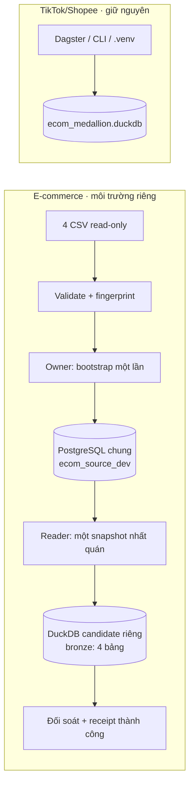

# Buổi 24/10 · DDL → bootstrap PostgreSQL → extract DuckDB

**Mục tiêu hôm nay:** tự viết và kiểm chứng đoạn `4 CSV → PostgreSQL source → DuckDB Bronze`. Môi trường Docker đã sẵn sàng; chưa nạp CSV hoặc tạo bốn bảng nghiệp vụ. File này là kế hoạch thực hành và code mẫu, **chưa phải implementation đã chạy**. Các lệnh hiện có và lệnh dự kiến được phân biệt bên dưới.

Code dbt được tổ chức trong `dbt/models/bronze`, `silver`, `gold`; Bronze mới có source declarations, chưa có dữ liệu. Chưa làm business SQL models, Gold, dashboard, DAG, CDC hoặc incremental/watermark trong buổi này. Làm xong Bronze và đối soát trước, rồi mới mở rộng.

## 1. DuckDB của TikTok có dùng lại được không?

Đã kiểm tra source tại `D:\Dev\Project\Tiktok_orders_pipeline`: project đó dùng **Dagster + dbt + DuckDB local trong `.venv`**, output hiện hành `data/duckdb/ecom_medallion.duckdb`. File `ecom_warehouse.duckdb` cũ vẫn được giữ. Đây là project khác với bộ CSV Xóm E-Com, dù tên file cũ cũng có chữ `ecom`.

| Thành phần | TikTok/Shopee hiện có | E-commerce trong buổi này |
| --- | --- | --- |
| Runtime/dependency | `.venv` của TikTok | Image `ecom-runtime:local-v1`, dependency lock riêng |
| Database DuckDB | `data/duckdb/ecom_medallion.duckdb` | Candidate riêng `/state/build/candidates/<extraction_id>/ecom_analytics.duckdb` |
| Storage | Thư mục local của TikTok | Volume `ecom-dev-build` |
| Điều phối | Dagster/CLI | CLI trong Docker; Airflow tích hợp sau |
| Có thể học lại | Writer lock, candidate, đối soát trước publish | Áp dụng cùng nguyên tắc, viết adapter/paths riêng |

**Không cần một DuckDB server chung.** Trong cách dùng embedded hiện tại, thư viện DuckDB chạy bên trong process Python/dbt và mở file của project. Chia sẻ PostgreSQL instance theo database/user khác với chia sẻ một file `.duckdb`. Mỗi project giữ file, lock, profile và dependency riêng; không mount volume TikTok hoặc trỏ `ECOM_DUCKDB_PATH` vào database TikTok. Không nâng package trong `.venv` TikTok để phục vụ e-commerce. [DuckDB concurrency](https://duckdb.org/docs/2.0/connect/concurrency.html).

TikTok hiện dùng candidate giữ cùng basename trước atomic replace; có thể tham khảo `pipeline_orchestration/warehouse.py`. E-commerce sẽ giữ basename `ecom_analytics.duckdb` trong mỗi thư mục candidate. Hôm nay chỉ tạo candidate Bronze đã kiểm chứng; chưa publish Gold hay thay active pointer.



## 2. Thứ tự làm và đầu ra

| Chặng | Việc làm | Đạt khi |
| --- | --- | --- |
| 0 | Kiểm môi trường/roles, đọc input contract | Owner/reader đúng; hiểu source và candidate nằm ở đâu |
| 1 | Profile types, null, precision, FK | Chốt được kiểu dữ liệu; không đoán format ngày/tiền |
| 2 | Viết DDL 4 bảng + ledger | PK/FK/types rõ; chưa chạy SQL thủ công ngoài bootstrap |
| 3 | Viết bootstrap atomic/idempotent | Đủ 4 bảng; retry cùng input không nhân dòng/reset nguồn |
| 4 | Viết snapshot extractor | 4 bảng Bronze lấy từ cùng snapshot PostgreSQL |
| 5 | Đối soát và thử lỗi | Counts/keys/totals khớp; lỗi không tạo receipt thành công |

Ước lượng học tập 4–6 giờ; đi theo checkpoint. Nếu contract chưa đạt thì ghi blocker, không bỏ validation để hoàn thành cho đủ số bước.

## 3. Chặng 0 · kiểm môi trường trước

**Các lệnh dưới đây đã có:**

```powershell
Set-Location 'D:\Dev\Project\e_commerce'
$ecomPlatformDir = 'D:\Dev\Project\airflow-platform'
.\scripts\Invoke-Dev.ps1 -Action Check -Role owner -PlatformDir $ecomPlatformDir
.\scripts\Invoke-Dev.ps1 -Action Check -Role reader -PlatformDir $ecomPlatformDir
```

Hiện `source_tables: 0` là đúng. Nếu warehouse đã tắt, xem phần bật riêng PostgreSQL trong [Docker runbook](../docker.md); không cần bật cả Airflow để viết CLI. Dùng cửa sổ shared scheduler OFF và preflight tài nguyên; không dừng một platform đang có công việc của project khác.

- PG source: `ecom_source_dev`; schemas đã có: `e_commerce`, `pipeline_meta`.
- Owner `ecom_owner` tạo/nạp bảng; `ecom_reader` chỉ SELECT nguồn, không đọc `pipeline_meta`.
- Runtime: 1024 MiB/1 CPU; DuckDB: 512 MB/1 thread, spill có trần; resource `ecom/refresh` đã đăng ký.
- Dagster/dbt/Streamlit TikTok chạy native trên Windows **không nằm trong Docker pool**. Chúng vẫn dùng RAM laptop; chủ động dừng công việc không cần dùng khi thử e-commerce, không suy ra Docker audit đã tính toàn bộ process Windows.
- Không chạy lại provisioning hoặc sinh mật khẩu mới chỉ để nạp CSV. Không dùng admin LapLapTech cho loader.

## 4. Chặng 1 · chốt contract trước DDL

Parser `ingestion/sources/csv_contracts.py` đã kiểm header, độ rộng dòng, khóa và checksum. `scripts/profile_csv.py` hiện chỉ có helper inventory; **chưa kiểm types/FK**. Bổ sung ở đây, giữ output là số liệu tổng hợp, không in customer records/email hoặc các khóa lỗi cụ thể.

| CSV | Số dòng baseline đã ghi nhận | PK dự kiến |
| --- | ---: | --- |
| `customer.csv` | 17.415 | `customer_id` |
| `product.csv` | 28.356 | `product_code` |
| `region.csv` | 3.828 | `region_code` |
| `ecom_sales.csv` | 51.290 | `row_id` |

Cần kiểm thêm:

1. Giữ identifiers là text để không mất số 0 đầu. Chốt chính sách whitespace/null markers; không trim hoặc đổi key âm thầm ở một phía của FK.
2. Đếm parse failures cho `birth_date`, `order_date`; chọn đúng format sau kiểm tra toàn cột, không đoán `DD/MM` hay `MM/DD` từ một dòng.
3. Dùng `Decimal` cho annual_income, sales, profit, discount và tọa độ. Ghi số chữ số phần nguyên/thập phân, nulls và non-finite; không chuyển qua float. Nếu có ký hiệu tiền/thousands separator, quy định parser rõ trước khi bỏ chúng.
4. Quantity phải là số nguyên trong phạm vi BIGINT; không tự áp `quantity > 0` nếu chưa xác nhận returns/adjustments.
5. Kiểm sales → customer/product/region bằng anti-join/set difference, chỉ ghi số orphan. Khi chưa có policy unknown/quarantine thì fail nếu FK thiếu, không inner join để làm mất dòng.
6. Không dedup sales theo `order_id` hoặc `(order_id, product_code)`. `row_id` là grain dòng nguồn; order grain/semantics sẽ xác minh thêm trước facts.

**Checkpoint:** lưu report local được ignore, chốt null policy và precision dùng chung PG/DuckDB. Các totals vẫn gọi là `source_reported_sales/profit`; chưa gán nghĩa gross/net hoặc cộng tiền như đã xác nhận currency.

## 5. Chặng 2 · viết DDL

File đích: `infra/postgres/init/010_source_schema.sql`. Folder có tên `init` nhưng file **không tự chạy** trong PostgreSQL chung đã tồn tại. Bootstrap sẽ đọc và execute nó bằng owner trong transaction.

**Mẫu khởi đầu dưới đây cần qua gate profiling:** `NUMERIC(38,10)`/`DECIMAL(38,10)` chỉ dùng nếu dữ liệu vừa precision/scale này. Phải reject giá trị vượt scale trước COPY để tránh PostgreSQL tự round; nếu không đạt, đổi contract và DDL trước khi load. Các `NOT NULL`/FK cũng là gate cần kiểm, không phải kết quả profiling đã được xác nhận.

```sql
-- Không thêm BEGIN/COMMIT: Python quản lý một transaction cho DDL + 4 COPY + ledger.
-- Schemas e_commerce và pipeline_meta đã tồn tại và thuộc ecom_owner.
CREATE TABLE e_commerce.customer (
    customer_id TEXT PRIMARY KEY,
    first_name TEXT, last_name TEXT, birth_date DATE,
    marital_status TEXT, gender TEXT, email_address TEXT,
    annual_income NUMERIC(38,10), education_level TEXT,
    occupation TEXT, home_owner TEXT
);

CREATE TABLE e_commerce.product (
    product_code TEXT PRIMARY KEY,
    product TEXT, category TEXT, subcategory TEXT
);

CREATE TABLE e_commerce.region (
    region_code TEXT PRIMARY KEY,
    city TEXT, state TEXT, country TEXT,
    country_latitude NUMERIC(38,10), country_longitude NUMERIC(38,10),
    region TEXT, market TEXT
);

CREATE TABLE e_commerce.ecom_sales (
    row_id TEXT PRIMARY KEY,
    order_id TEXT NOT NULL,
    order_date DATE NOT NULL,
    customer_id TEXT NOT NULL REFERENCES e_commerce.customer(customer_id),
    segment TEXT,
    region_code TEXT NOT NULL REFERENCES e_commerce.region(region_code),
    product_code TEXT NOT NULL REFERENCES e_commerce.product(product_code),
    quantity BIGINT NOT NULL,
    sales NUMERIC(38,10), discount NUMERIC(38,10), profit NUMERIC(38,10)
);

CREATE TABLE pipeline_meta.bootstrap_runs (
    singleton SMALLINT PRIMARY KEY DEFAULT 1 CHECK (singleton = 1),
    bootstrap_id CHAR(64) UNIQUE NOT NULL,
    contract_version TEXT NOT NULL,
    files JSONB NOT NULL,
    loaded_at TIMESTAMPTZ NOT NULL DEFAULT CURRENT_TIMESTAMP
);
```

Ledger chỉ cho một baseline initial load; JSON chứa tên bảng/file, SHA-256, row count, không chứa records hoặc password. Dùng cùng `contract_version` trong parser và fingerprint. `home_owner`/gender/status giữ TEXT cho tới khi mapping enum được xác nhận.

Không `DROP`, `TRUNCATE`, `CREATE OR REPLACE` hoặc tự migrate bảng cũ. Nếu đã có bảng nhưng không có ledger/schema tương ứng, dừng để kiểm tra trạng thái. Không dùng `IF NOT EXISTS` để che schema drift. Default privilege đã cấp reader SELECT cho bảng do **ecom_owner** tạo trong `e_commerce`; không cấp reader quyền trên ledger.

## 6. Chặng 3 · bootstrap 4 CSV một lần

File đích: `scripts/bootstrap/load_csv.py`. Đọc/validate/hash **cùng payload sẽ load**; không đọc lại một file đã thay đổi sau khi tính hash. Bộ dữ liệu hiện nhỏ nên có thể giữ payload/typed rows trong giới hạn RAM; đo lại nếu tăng dữ liệu.

Luồng cần viết:

```text
đủ 4 CSV → validate + typed rows + file hashes
→ bootstrap_id = SHA256(canonical JSON(contract_version + 4 file hashes))
→ giữ build-volume writer lock
→ mở PG bằng ecom_owner, guard trên chính connection này
→ một transaction + pg_advisory_xact_lock dành riêng bootstrap ecom
    kiểm schema/columns/types/constraints thực tế đúng contract trước khi skip
    nếu có ledger cùng contract/fingerprint và schema hợp lệ: SKIP, không nạp lại
    nếu ledger khác: FAIL, không reset baseline
    nếu có source tables nhưng thiếu ledger: FAIL, không sửa tự động
    nếu chưa có source tables/ledger:
        execute DDL
        COPY customer → product → region → ecom_sales
        đối soát counts và totals với typed input
        INSERT ledger
→ COMMIT; lỗi bất kỳ bước nào thì ROLLBACK toàn bộ
```

Guard phải xác nhận `current_database() = ecom_source_dev`, `current_user = ecom_owner`, role không có superuser/createdb/createrole/replication/bypassrls. File lock bảo vệ CLI cùng volume; PG advisory transaction lock còn ngăn hai bootstrap không vô tình cùng thấy ledger rỗng. Chọn hằng số lock riêng cho ecom, không dùng lock ID project khác.

**Mẫu helper COPY hoàn chỉnh cho một bảng**; caller vẫn cần transaction/ledger/guard phía trên:

```python
from psycopg import sql
from ingestion.sources.csv_contracts import CONTRACTS

def copy_table(cur, table, typed_rows):
    if table not in CONTRACTS:
        raise ValueError("Unknown source table")
    columns = CONTRACTS[table][1]
    statement = sql.SQL("COPY {} ({}) FROM STDIN").format(
        sql.Identifier("e_commerce", table),
        sql.SQL(", ").join(sql.Identifier(c) for c in columns),
    )
    with cur.copy(statement) as stream:
        for values in typed_rows:
            stream.write_row(values)
```

`typed_rows` chứa tuples đúng thứ tự headers, dùng `date`, `Decimal`, `int`, `str`, `None` theo contract. `write_row()` không đi cùng `FORMAT CSV`/`HEADER`. PK/FK lỗi phải rollback; không `ON CONFLICT DO NOTHING` để che duplicate. [Psycopg COPY](https://www.psycopg.org/psycopg3/docs/basic/copy.html).

Retry cùng fingerprint chỉ xác nhận baseline đã được load; **không yêu cầu source hiện tại vẫn khớp CSV**, vì sau này PG có thể có OLTP changes. Nguồn chưa có ledger thì chỉ được nhận nếu trạng thái initial load hợp lệ; tuyệt đối không tự xóa để sửa lỗi.

**Checkpoint:** bốn bảng source và một ledger row cùng commit; reader đọc được bốn bảng, không đọc ledger. Gọi lại cùng input trả `skipped`, counts không tăng. Không log giá trị khách hàng kể cả khi COPY báo lỗi; error/report chỉ giữ stage, table, record ordinal, loại lỗi/SQLSTATE.

## 7. Chặng 4 · extract PostgreSQL → DuckDB Bronze

File đích: `ingestion/loaders/postgres_to_duckdb.py`. Extraction chỉ dùng `ecom_reader`; **không gọi bootstrap lại** và không đọc trực tiếp CSV để giả lập source extraction.

1. Giữ cùng `build_lock()` trên volume ecom. Tạo UUID `extraction_id`; guard path nằm dưới `/state/build/candidates/` và chưa tồn tại. Candidate dùng basename `ecom_analytics.duckdb`, không dùng tên/path của TikTok.
2. Mở PG với `autocommit=True`, rồi mở **một** transaction `REPEATABLE READ READ ONLY` trước SELECT đầu tiên. Guard đúng database/reader trên connection đó.
3. Ghi `pg_current_snapshot()::text`, snapshot timestamp và extraction UUID vào receipt. Snapshot token để audit, không phải bản backup có thể dùng lại sau khi transaction kết thúc. Reader không cần quyền đọc `pipeline_meta`.
4. Mở candidate DuckDB với memory limit/threads/spill đã cấu hình. Tạo schema `bronze`, DDL tường minh cho bốn bảng, một transaction ghi toàn candidate.
5. Named/server-side cursor, `fetchmany(1000)`; insert parameterized vào DuckDB. Không `fetchall()` toàn nguồn, không cast Decimal qua float hoặc DataFrame tự suy kiểu.
6. Counts, distinct keys, null counts và `SUM(sales/profit/quantity)` nguồn phải lấy **trong cùng PG transaction**, so với candidate. Nếu cần mạnh hơn, đối chiếu hash canonical theo key; row count một mình chưa chứng minh mọi giá trị bằng nhau.
7. Chỉ sau khi đối soát đạt: commit/close DuckDB, đóng PG; mở lại candidate `read_only=True` để kiểm. Viết receipt thành công local. Lỗi thì không có receipt `validated`; candidate lỗi không được phục vụ.

Mẫu điều khiển snapshot **chưa phải extractor đầy đủ**. Caller phải tạo DuckDB tables, thực hiện `write_batch`, reconciliation và giữ lock. `guard_pg_identity` là helper cần refactor/bổ sung trong code runtime để kiểm trên đúng connection:

```python
from psycopg import sql
from ingestion.sources.csv_contracts import CONTRACTS

def extract_tables(pg, write_batch):
    # pg được mở autocommit=True; không có transaction ngầm từ một SELECT trước đó.
    with pg.transaction():
        pg.execute("SET TRANSACTION ISOLATION LEVEL REPEATABLE READ, READ ONLY")
        guard_pg_identity(pg, expected_user="ecom_reader")
        snapshot, started_at = pg.execute(
            "SELECT pg_current_snapshot()::text, transaction_timestamp()"
        ).fetchone()
        for table, (_, columns) in CONTRACTS.items():
            query = sql.SQL("SELECT {} FROM {}").format(
                sql.SQL(", ").join(sql.Identifier(c) for c in columns),
                sql.Identifier("e_commerce", table),
            )
            with pg.cursor(name=f"ecom_{table}") as cur:
                cur.execute(query)
                while rows := cur.fetchmany(1000):
                    write_batch(table, rows, started_at)
        # Lấy source counts/keys/nulls/totals ở đây, trước khi ra khỏi transaction.
        # Callback/caller phải đối soát với cùng candidate, không mở snapshot PG khác.
        return snapshot, started_at
```

Một PG transaction cho bốn bảng giữ chúng cùng snapshot; bốn connection riêng hoặc default READ COMMITTED cho từng SELECT có thể nhìn nguồn ở thời điểm khác nhau. [PostgreSQL Repeatable Read](https://www.postgresql.org/docs/16/transaction-iso.html#XACT-REPEATABLE-READ).

**Bronze DDL:** tên/columns lấy từ allowlist `CONTRACTS`; mapping `TEXT→VARCHAR`, `DATE→DATE`, `BIGINT→BIGINT`, `NUMERIC(38,10)→DECIMAL(38,10)` sau khi chốt precision. Giữ PK của snapshot nếu engine hỗ trợ phù hợp hoặc kiểm unique/not-null bằng SQL, không tự dedup. Thêm `_extraction_id VARCHAR`, `_extracted_at TIMESTAMPTZ`, `_source_table VARCHAR` vào mỗi dòng. `write_batch` append cùng UUID/timestamp/source name và dùng `executemany` với placeholders, không chèn giá trị bằng f-string.

Mỗi extraction tạo candidate mới đủ bốn bảng; không append nhiều full snapshots vào một fact input. Chưa cần watermark/lookback cho snapshot ban đầu. Source snapshot mới không được nhận diện chỉ bằng hash CSV baseline.

Receipt dự kiến lưu `/state/artifacts/extract/<extraction_id>/receipt.json`, chỉ chứa đường dẫn candidate, UUID, snapshot token, timestamps, contract version, counts/totals/check results; không chứa raw rows, email, credentials. Report JSON có Decimal thì serialize dạng decimal string. Bronze có PII và nằm trong private build volume, chưa phải file được public hoặc dùng làm Gold serving. Các đường dẫn `/state/...` là bên trong container/volume Docker, không phải thư mục DuckDB local của TikTok trên ổ D:.

## 8. Nối code mới vào Docker/CLI

**Các mục dưới đây cần viết trước khi có lệnh Bootstrap/Extract:**

| File | Thay đổi cần làm |
| --- | --- |
| `ingestion/sources/csv_contracts.py` và `scripts/profile_csv.py` | Type/null/precision/FK contract + report aggregate, giữ parser hiện có |
| `infra/postgres/init/010_source_schema.sql` | DDL ở chặng 2 sau khi contract đạt |
| `scripts/bootstrap/load_csv.py` | Bootstrap owner, transaction/ledger/COPY; helper không tự commit |
| `ingestion/loaders/postgres_to_duckdb.py` | Reader snapshot, candidate, batch, đối soát và receipt |
| `scripts/environment.py` | Thêm dispatch `bootstrap`/`extract`, guard theo connection/role; giữ check/debug hiện có |
| `scripts/Invoke-Dev.ps1` | Thêm actions `Bootstrap`/`Extract`, mapping commands, kiểm Role; giữ nguyên preflight/limits |
| `infra/docker/runtime.Dockerfile` | Copy `scripts/` và DDL vào image; vẫn exclude data/secrets, giữ non-root/lock |

Dockerfile hiện chỉ copy `scripts/environment.py`, vì vậy tạo Python file trên host **chưa làm nó xuất hiện trong image**. Khi code xong, thay COPY scripts bằng `COPY scripts /app/scripts`, thêm `COPY infra/postgres/init /app/infra/postgres/init`, rồi rebuild. Không bind mount thư mục TikTok hoặc copy `.venv` của nó.

**Giao diện lệnh dự kiến sau khi hoàn thành wiring, chưa chạy được ở thời điểm viết plan:**

```powershell
Set-Location 'D:\Dev\Project\e_commerce'
$ecomPlatformDir = 'D:\Dev\Project\airflow-platform'
.\scripts\Invoke-Dev.ps1 -Action Build -PlatformDir $ecomPlatformDir
.\scripts\Invoke-Dev.ps1 -Action Bootstrap -Role owner -PlatformDir $ecomPlatformDir
.\scripts\Invoke-Dev.ps1 -Action Extract -Role reader -PlatformDir $ecomPlatformDir
```

Sai Role phải fail trước ghi. Không bỏ wrapper resource guard để chạy được command mới. Helpers bootstrap/extract nên nhận connection/callback; top-level command giữ lock. Buổi sau khi ghép extract→dbt→publish, runner phải giữ **một lock xuyên suốt**, tránh vừa thả khóa giữa các stage vừa tưởng đã an toàn.

## 9. Chặng 5 · đối soát và thử lỗi

| Thử nghiệm | Kết quả bắt buộc |
| --- | --- |
| Initial bootstrap | Counts source khớp typed input, ledger đúng hashes/version; cả bốn bảng cùng commit |
| Retry cùng input | `skipped`; không tăng count hoặc nạp lại |
| CSV khác sau bootstrap | Báo cần workflow new-baseline; nguồn và ledger giữ nguyên |
| Input thứ tư lỗi/COPY lỗi | Không commit ba bảng đầu hoặc ledger dở |
| Sai DB/user/path | Fail trước khi ghi source/candidate |
| Quyền reader | SELECT nguồn đạt; INSERT/CREATE và SELECT ledger bị từ chối |
| Hai bootstrap/writers | File lock và PG advisory lock chặn chạy chồng; bỏ container thì lock được nhả |
| Full extraction | Bốn bảng Bronze, PK unique/non-null, counts/nulls/totals khớp cùng source snapshot |
| Source đổi giữa extract | Fixture chứng minh snapshot không trộn trước/sau thay đổi |
| Extract lỗi ở bảng giữa | Không receipt thành công; lần retry tạo candidate mới, không append duplicate |
| Candidate sau close | Mở read-only được; lineage UUID thống nhất; không động database TikTok |

Thử rollback, concurrent source changes và lỗi dữ liệu trên **synthetic fixtures có target riêng, được guard rõ**; không sửa/xóa customer thật hoặc dữ liệu TikTok để test. Nếu chưa có fixture/test target, ghi phần kiểm này là chưa làm và triển khai nó trước khi tuyên bố đảm bảo rollback/snapshot. Counts thực sau OLTP có thể khác baseline CSV; extraction đối chiếu PG snapshot hiện tại, không ép về 100.889 dòng mãi mãi.

### Checklist kết buổi

- [ ] Chốt types/date format/precision/null/FK bằng profiling aggregate.
- [ ] Viết DDL và bootstrap transaction + ledger; thử initial/retry/rollback.
- [ ] Owner và reader đúng quyền; không phát tán credential admin.
- [ ] Extract đủ bốn bảng vào candidate riêng; giữ Decimal/date và lineage.
- [ ] Đối soát cùng snapshot, thử failed extraction và writer lock.
- [ ] Ghi kết quả thực tế và các test chưa làm; không tick chỉ vì đã viết code.
- [ ] `git status` không có CSV, password, `.duckdb`, reports/logs chứa PII.

**Sau buổi này:** dbt Bronze sources → staging → facts/marts → đối soát → immutable Gold-only publish; Airflow gọi command refresh sau khi CLI đã ổn. Không cần thay đổi project TikTok để đạt các đầu ra hôm nay.
